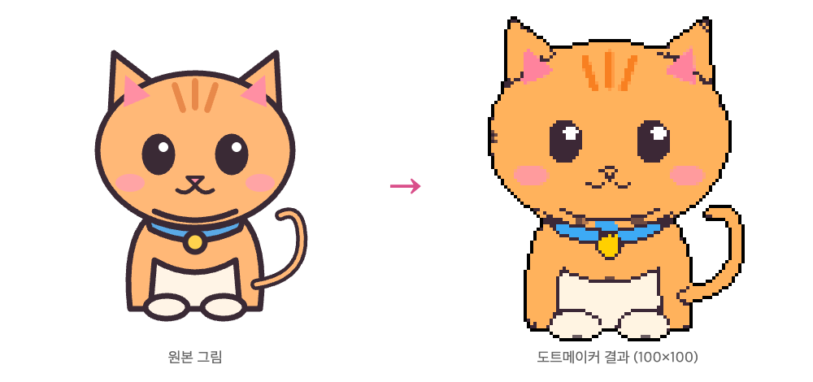
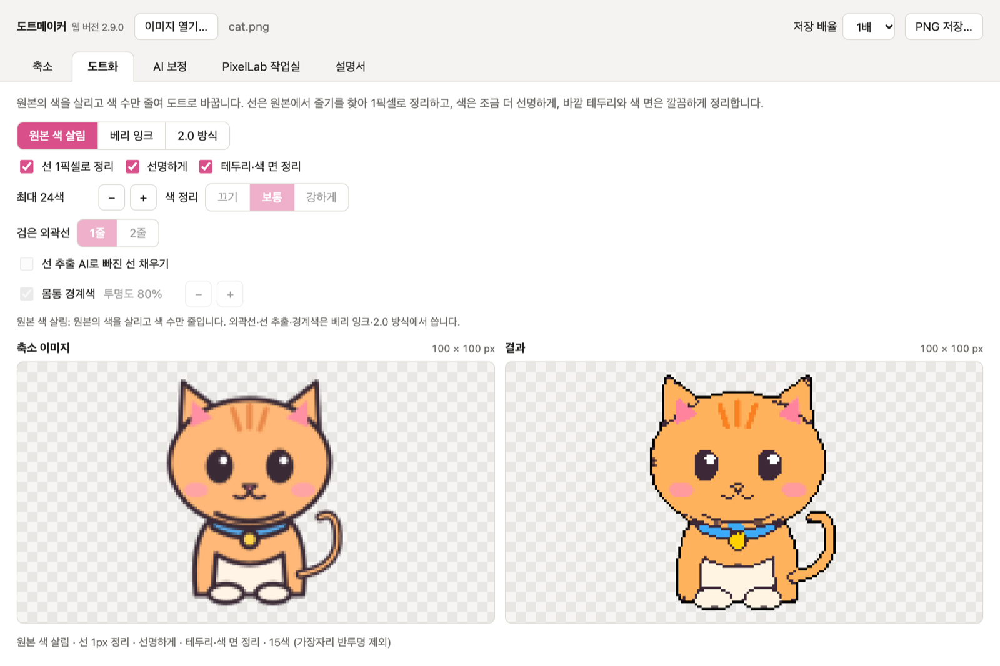

<div align="center">

# 🎨 도트메이커

**캐릭터 그림을 넣으면 원본을 살린 도트(픽셀) 그림으로 바꿔 주는 프로그램**



</div>

---

## 💾 받기

[**최신 버전 받기 (Releases)**](https://github.com/YSoung99/dotmaker/releases/latest) — 윈도우용·맥용·리눅스용이 한 페이지에 같이 있습니다.

| 운영체제 | 받을 파일 | 설치 방법 |
|---|---|---|
| **윈도우** 10/11 (64비트) | `DotMaker-…-win-x64.exe` | 받은 파일을 실행 → 설치 위치 고르고 **설치**. "Windows의 PC 보호" 창이 뜨면 **추가 정보 → 실행** |
| **맥** (Apple Silicon, macOS 14 이상) | `DotMaker-…-mac-arm64.dmg` | 파일을 열어 **DotMaker**를 **응용 프로그램** 폴더로 끌어다 놓기. 처음 한 번 아래 명령 실행 |
| **리눅스** 우분투·데비안·민트 (64비트) | `DotMaker-…-linux-amd64.deb` | 받은 파일을 두 번 눌러 설치하거나 `sudo apt install ./DotMaker-…-linux-amd64.deb`. 프로그램 목록에서 **DotMaker** 실행 |
| **리눅스** 그 밖의 배포판 (64비트) | `DotMaker-…-linux-x86_64.AppImage` | 설치 없이 실행하는 파일. 아래 리눅스 안내 참고 |

맥은 개발자 서명이 없는 앱이라, 처음 열기 전에 터미널에서 아래 명령을 한 번 실행하세요.

```sh
xattr -dr com.apple.quarantine /Applications/DotMaker.app
```

리눅스 AppImage는 실행 권한을 준 뒤 실행합니다. 우분투 22.04 이상에서 `error loading libfuse.so.2`가 나오면 FUSE 라이브러리를 먼저 설치하세요(우분투 24.04는 `libfuse2t64`, 22.04는 `libfuse2`). 한글이 네모로 보이면 한글 글꼴(`fonts-noto-cjk` 등)을 설치하세요.

```sh
sudo apt install libfuse2t64
chmod +x DotMaker-*-linux-x86_64.AppImage
./DotMaker-*-linux-x86_64.AppImage
```

## 🚀 쓰는 법

1. **이미지 열기…** 로 캐릭터 그림을 엽니다(창에 끌어다 놓거나 붙여넣어도 됩니다). 여러 장을 넣으면 한꺼번에 도트화해 폴더에 저장합니다.
2. **결과 크기**와 **도트화 방식**을 고르면 바로 다시 그립니다.
3. **PNG 저장…** 으로 투명 배경 도트 그림을 저장합니다.

자세한 설명은 프로그램 안의 **설명서** 탭에 있습니다.



## ✨ 할 수 있는 것

- **원본 보존** 도트화(결과 크기 50×50 ~ 200×200), 원본 색 살림 · 베리 잉크 · 2.0 방식 · 원본 직행
- **AI 업스케일(ESRGAN)**: 도트화하기 전에 원본을 4배로 키워 흐린 선·잡티를 정리합니다. 자동(원본이 결과 크기의 4배보다 작을 때만) · 6B(더 깔끔) · v3(더 빠름) · 끄기 중에서 고르고, AI 보정 탭의 다시 그린 그림에도 적용됩니다.
- 바깥 외곽선 1픽셀(원본 선 색) · 원본 색 맞추기 · 경계 섞인 색 정리 · 작은 입선 보존, **JEV 부위별 진단 · 섞인 색 판정 · 선·색 비교 · 자동 선택**([LLM Gateway](https://llmgateway.io) API 키 필요, 판정할 때 그림이 전송되고 요금은 내 계정에 청구)
- AI 보정: PixelLab · Gemini · OpenAI(각 서비스의 내 API 키 필요)
- 맥·윈도우·리눅스 프로그램은 **같은 코드로 만들어** 기능과 결과가 같습니다.
- AI 기능(AI 업스케일·배경 분리·선 추출)에 쓰는 파일은 **처음 쓸 때 한 번 자동으로 받습니다**(인터넷 필요). 그래서 설치 파일이 가볍습니다.
- **새 버전 알림**: 새 버전이 나오면 프로그램 위쪽에 받기 링크가 뜹니다.
- **품질 옵션**: **또렷하게(작은 크기용)** 는 칸 색을 평균 내지 않고 선·면 색 하나로 골라 작은 크기에서 뭉개짐을 줄입니다. 가장자리 반투명 없애기 · 강조색 지키기 · 팔레트 고정 · 외톨이 점 정리도 고를 수 있습니다.
- **실험 탭(베타)**: 도트 크기와 색 수만 골라 그림을 도트로 바꿉니다. **배경 지우기**를 끄면 배경 있는 일러스트 전체를 배경째 바꾸고, 줄이는 방식(평균·투표)을 고를 수 있으며, 자동 추출(원본 색감 유지)과 커스텀 팔레트(정한 색만)를 고를 수 있습니다.
- **편의 기능**: 마지막 설정 기억, 캡처한 그림 붙여넣기(Ctrl/⌘+V), 결과 복사(Ctrl/⌘+C), 여러 장을 한꺼번에 도트화해 폴더에 저장, 결과 자리에서 **원본 보기**로 비교.
- AI 업스케일이 어떤 이유로 실패하면 그림은 업스케일 없이 도트화하고, 상태줄에 'AI 업스케일 건너뜀'으로 알려 줍니다.

## 🛠️ 고쳐서 쓰기

맥·윈도우·리눅스 프로그램이 이 저장소의 코드 하나로 만들어집니다. 한 번 고치면 모두에 똑같이 반영됩니다.

| 바꾸고 싶은 것 | 고칠 곳 |
|---|---|
| 결과 크기 범위·간격·처음 크기, 새 버전 알림이 보는 저장소 | [`src/settings.js`](src/settings.js) |
| AI 파일 받는 주소 | `src/files.js` |
| 고정 팔레트 목록 추가 | `src/core.js`의 `PALETTES` |
| 프로그램 버전 | [`package.json`](package.json)의 `"version"` (화면과 설치 파일 이름에 자동 반영) |
| 화면(버튼·문구·설명서) | `src/app.js`, `src/app.html` |
| 실험 탭(베타) | `src/lab.js` |
| 도트화 계산 | `src/core.js` |
| AI(업스케일·배경 분리·선 추출) | `src/ai.js`, `src/worker.js` |
| AI 보정(클라우드)·JEV | `src/cloud.js`, `src/jev-app.js`, `src/jev-core.js` |
| 프로그램 창·키 저장 | `desktop/main.cjs` |

Node.js 18 이상이 필요합니다.

```bash
npm install        # 처음 한 번
npm start          # 고친 내용을 바로 실행해 보기
npm run dist       # 설치 파일 만들기: release/ 에 윈도우 .exe, 맥 .dmg, 리눅스 .deb·.AppImage (맥에서 실행)
```

`npm run dist:win`, `npm run dist:mac`, `npm run dist:linux`로 한쪽만 만들 수도 있습니다. `dist/`와 `release/`는 만들어지는 파일이라 저장소에 올리지 않습니다.

AI 업스케일 모델(ONNX)은 [models-esrgan 릴리스](https://github.com/YSoung99/dotmaker/releases/tag/models-esrgan)에 있고, [dotmaker-mac의 scripts/export-esrgan.py](https://github.com/YSoung99/dotmaker-mac/blob/main/scripts/export-esrgan.py)로 공식 가중치에서 다시 만들 수 있습니다.

## 📝 업데이트 기록

- **3.9.3**: 실험 탭에 새 도트 방식 **투표**를 넣었습니다(줄이는 방식에서 고름). 칸마다 가장 넓은 색 영역을 고르고 그 영역의 원본 색으로 칠해, 작은 크기에서도 선이 또렷합니다. 가는 선을 지키는 **작은 디테일 지키기**, 끊긴 바깥선을 잇는 **외곽선 틈 메우기**도 함께 넣었습니다. 리눅스에서 프로그램 아이콘이 보이지 않던 문제를 고쳤습니다.
- **3.9.2**: **리눅스판 추가**(우분투·데비안용 `.deb`, 그 밖의 배포판용 `.AppImage`). 기능과 설정은 맥·윈도우와 같습니다. 실험 탭에 **배경 지우기**(기본 켬)를 넣었습니다. 끄면 예전처럼 그림 전체를 배경째 바꿉니다. 프로그램 **아이콘을 새로** 바꿨습니다(왼쪽은 원본, 오른쪽은 도트).
- **3.9.1**: **AI 보정 탭과 실험 탭에도 결과 크기 선택**을 넣었습니다. AI 보정 탭은 도트화 탭과 같은 크기를 쓰고, 실험 탭은 긴 변 칸 수를 고르면 원본 비율 그대로 그 크기에 맞춥니다.
- **3.9.0**: **실험 탭(베타)** 추가. 캐릭터를 오려 내지 않고 그림 전체를 배경째 도트로 바꿉니다(도트 크기, 자동 8~256색 추출, 색 칸을 눌러 고치는 커스텀 팔레트).
- **3.8.1**: 캐릭터를 분리하지 못했을 때 그냥 실패하지 않고, **분리 없이 그대로 변환**을 고를 수 있습니다.
- **3.8.0**: 도트 품질 옵션 5가지(모두 기본 꺼짐). **또렷하게(작은 크기용)**, 가장자리 반투명 없애기, 강조색 지키기, 팔레트 고정(PICO-8·Sweetie 16·게임보이·직접 입력), 외톨이 점 정리.
- **3.7.0**: 마지막에 쓰던 설정을 기억합니다. 그림 붙여넣기와 결과 복사, 여러 장 한꺼번에 도트화, 결과 자리에서 원본 보기(비교)를 넣었습니다.
- **3.6.0**: 설치 파일이 가벼워졌습니다(안 쓰는 언어 파일을 빼고, AI 파일은 처음 쓸 때 받음). 새 버전이 나오면 프로그램 위쪽에 알림이 뜹니다. 남아 있던 웹 버전 문구를 정리했습니다.
- **3.5.0**: 맥과 윈도우 프로그램을 **코드 하나로 통합**했습니다. 받는 곳도 이 저장소 한 곳입니다. 맥 앱은 `DotMaker.app`(.dmg)으로 바뀌었고 결과는 예전 맥 앱과 같습니다. 자주 바꾸는 값은 `src/settings.js`에 모았습니다.
- **3.4.0**: 결과 크기를 **50×50부터** 고를 수 있습니다(50 ~ 200, 10px 단위). 도트화 탭과 AI 보정 탭이 같은 크기를 씁니다.
- **3.3.0**: 맥 앱과 윈도우 프로그램의 기능을 모두 같게 맞췄습니다. 원본 색 살림·원본 직행 방식, 선 추출 AI, AI 보정 탭(PixelLab·Gemini·OpenAI), 설명서 탭, JEV 선·색 비교와 자동 선택. 윈도우는 인터넷 없이도 AI 업스케일이 되고, 실패하면 업스케일 없이 도트화합니다.
- **3.2.1**(윈도우): 인터넷 없이도 AI 업스케일, 업스케일이 실패해도 그림은 열기.
- **3.2.0**: 바깥 외곽선 1픽셀을 원본 선 색으로, 원본 색 맞추기(기본 끔).
- **3.1.0**: AI 업스케일(Real-ESRGAN 4배, 자동·6B·v3·끄기), 작은 입선 보존.
- **3.0.0**: 첫 공개. 원본 보존 도트화(100×100 ~ 200×200), 바깥 외곽선 1픽셀 검정, 경계 섞인 색 정리, 배경 분리 AI, JEV 부위별 진단·섞인 색 판정.

## 📄 라이선스

[MIT](LICENSE). 함께 쓰는 AI 파일은 각자의 라이선스를 따릅니다.

- AI 업스케일: [Real-ESRGAN](https://github.com/xinntao/Real-ESRGAN) RealESRGAN_x4plus_anime_6B · realesr-animevideov3 (BSD-3-Clause) — ONNX로 바꿔 [models-esrgan 릴리스](https://github.com/YSoung99/dotmaker/releases/tag/models-esrgan)에 올린 것
- 배경 분리: [skytnt/anime-seg](https://huggingface.co/skytnt/anime-seg) (Apache-2.0)
- 선 추출: [p1atdev/MangaLineExtraction-hf](https://huggingface.co/p1atdev/MangaLineExtraction-hf) (MIT) — `src/lines-graph.onnx`는 이 모델의 구조를 ONNX로 옮긴 것
- 실행 도구: [onnxruntime-web](https://github.com/microsoft/onnxruntime) (MIT) · 프로그램 본체: [Electron](https://www.electronjs.org/) (MIT)

README의 예시 고양이 그림은 이 저장소용으로 새로 그린 것입니다.

> 예전 맥 전용 앱(Swift) 소스는 [YSoung99/dotmaker-mac](https://github.com/YSoung99/dotmaker-mac)에 보관되어 있습니다(3.4.0까지). 브라우저로 여는 웹 버전(2.9.0)은 2026-11-10에 배포를 끝냈습니다.
